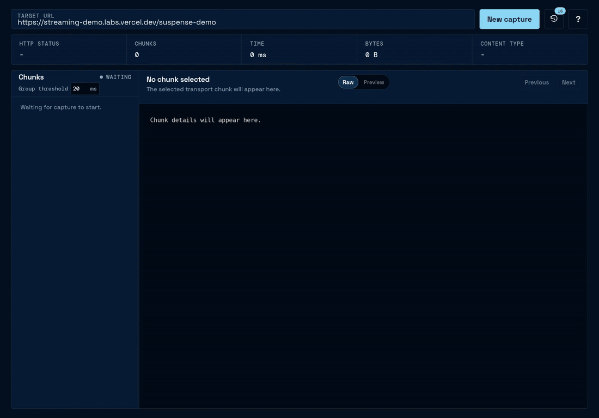

<h1>HTTP Scope </h1>

HTTP Scope captures individual chunks from HTTP streams and renders partial HTML responses in the built-in preview. It uses a backend capture service to avoid browser CORS restrictions and provide a consistent environment for observing response chunking and loading behavior.

## HTML Preview



This shows a capture of Vercel's [Next.js suspense streaming example](https://nextjs.org/docs/app/guides/streaming#verifying-that-streaming-works).

## Getting Started

### Install from Source

Requires Node.js and npm. The required Node.js and npm versions are defined in `package.json`.

```sh
git clone https://github.com/dejohansson/http-scope.git
```

```sh
cd http-scope
```

```sh
npm install
```

### Start Development Server

```sh
npm run dev
```

### Production Build & Start

```sh
npm run build
```

```sh
npm start
```
